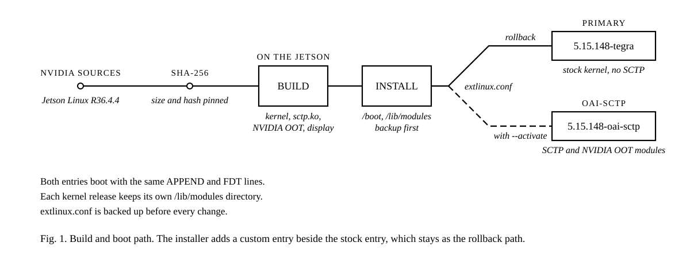

# Jetson Orin Nano SCTP Kernel

**[Quick start](#quick-start)** · **[Rollback](#rollback)** · **[Pinned sources](sources.env)** · **[OAI split-DU testbed](https://github.com/promaaa/oai-cu-du-lab)** · **[Paper (PDF)](https://github.com/promaaa/oai-cu-du-lab/blob/main/docs/PDFs/research-paper.pdf)**

[](https://github.com/promaaa/jetson-kernel-sctp/actions/workflows/ci.yml)
[](#at-a-glance)
[](sources.env)
[](LICENSE)

The stock kernel of the Jetson Orin Nano, `5.15.148-tegra`, is built without SCTP. `modprobe sctp` fails with `Module sctp not found`, and every program that opens an SCTP socket stops there. One of them is the OpenAirInterface 5G distributed unit (DU), whose F1-C link to the central unit runs over SCTP.

This repository rebuilds the whole kernel from NVIDIA's pinned source bundle with `CONFIG_IP_SCTP=m`. It builds the NVIDIA out-of-tree (OOT) and display modules against the same tree, then installs the result beside the stock kernel. The stock boot entry stays untouched as the way back.



## At a glance

| Category | Configuration |
|---|---|
| Target | Jetson Orin Nano Developer Kit |
| Platform | Jetson Linux R36.4.4 / JetPack 6.2.1 |
| Kernel change | `CONFIG_IP_SCTP=m`, release suffix `-oai-sctp` |
| Build | Native `aarch64` build from a SHA-256-pinned NVIDIA bundle |
| Boot | New `oai-sctp` entry, stock `primary` entry kept |
| Rollback | Pick `primary` at boot, or restore the `extlinux.conf` backup |

**Why not build only `sctp.ko`?** A module must match the exact build of the running kernel. In the lab, a separately built `sctp.ko` failed to load on the stock kernel. A full rebuild gives one kernel release whose in-tree, NVIDIA OOT and display modules all come from the same tree.

## Used in

This kernel lets a Jetson Orin Nano run the DU of a real-radio OpenAirInterface split testbed ([oai-cu-du-lab](https://github.com/promaaa/oai-cu-du-lab)). The Jetson DU drives a USRP B210 in band n78 and keeps 87.5–89.0 % of an x86 DU's handset downlink on all three F1 links:

| F1 link | Jetson Orin Nano | x86 mini PC | Jetson / x86 |
|---|---:|---:|---:|
| Ethernet | 87.9 | 99.4 | 88.4 % |
| Wi-Fi with GRE | 45.3 | 51.8 | 87.5 % |
| 5G with WireGuard | 67.8 | 76.2 | 89.0 % |

Mean handset downlink in Mbps, 20 trials per configuration. The Jetson, B210 and 5G modem weigh 657.4 g and draw about 28 W under sustained traffic.

## Quick start

Requirements: a Jetson Orin Nano on Jetson Linux R36.4.4 / JetPack 6.2.1, internet access, `sudo`, free storage, and a serial console or another way to recover the boot files.

```bash
git clone https://github.com/promaaa/jetson-kernel-sctp.git
cd jetson-kernel-sctp

./scripts/build_kernel.sh      # download, verify and build on the Jetson
./scripts/install_kernel.sh    # install beside the stock kernel
```

The first install keeps `DEFAULT primary` and appends this entry to `/boot/extlinux/extlinux.conf`. Its `APPEND` line, and any `FDT` or `OVERLAYS` line, are copies of the stock entry's lines:

```
LABEL oai-sctp
      MENU LABEL custom SCTP kernel 5.15.148-oai-sctp
      LINUX /boot/Image-5.15.148-oai-sctp
      INITRD /boot/initrd.img-5.15.148-oai-sctp
      APPEND ${cbootargs} root=PARTUUID=... rw rootwait ...
```

Review the file and its timestamped backup, then make the custom entry the default:

```bash
./scripts/install_kernel.sh --activate
sudo reboot
./scripts/verify_kernel.sh     # after the reboot
```

`verify_kernel.sh` checks that the running release contains `oai-sctp`, loads the `sctp` module, queries SCTP support with `checksctp`, and runs `nvidia-smi` to confirm the NVIDIA driver stack.

## Commands

| Task | Command |
|---|---|
| Build the kernel and modules | `./scripts/build_kernel.sh` |
| Install, keep the default entry | `./scripts/install_kernel.sh` |
| Install and select the custom entry | `./scripts/install_kernel.sh --activate` |
| Verify after reboot | `./scripts/verify_kernel.sh` |
| Check shell scripts | `shellcheck scripts/*.sh tests/*.sh` |
| Test boot-entry updates | `tests/extlinux.test.sh` |

## Settings

The build works in `~/jetson-kernel-build`, outside the repository. Environment variables override the defaults:

| Variable | Default | Purpose |
|---|---|---|
| `JETSON_KERNEL_WORKSPACE` | `~/jetson-kernel-build` | Downloads, extracted sources and build records |
| `JETSON_KERNEL_BUILD_JOBS` | `4` | Parallel build jobs |
| `JETSON_KERNEL_SWAP_FILE` | `/swapfile_build` | Build swapfile, created when RAM is below 12 GB |
| `JETSON_KERNEL_SWAP_SIZE_GB` | `4` | Build swapfile size |
| `JETSON_EXTLINUX_CONF` | `/boot/extlinux/extlinux.conf` | Boot configuration that the installer edits |
| `JETSON_KERNEL_EXPECTED_MARKER` | `oai-sctp` | Text that `verify_kernel.sh` expects in `uname -r` |

```bash
JETSON_KERNEL_WORKSPACE=/mnt/nvme/jetson-kernel-build ./scripts/build_kernel.sh
```

The build swapfile stays on disk. It is not added to `/etc/fstab`, so it is inactive after the next reboot. Then you can delete it with `sudo rm /swapfile_build`.

## Pinned inputs

[`sources.env`](sources.env) records the Jetson Linux and JetPack versions, the official NVIDIA source URL, the archive size and SHA-256 checksum, and the kernel release suffix. The build checks the archive before extraction. If NVIDIA changes the bytes behind the same URL, the build stops until someone reviews and updates the pin.

The build derives the final release with `make kernelrelease`. It writes the repository commit, source, compiler, package versions and kernel release to `build-inputs.txt` beside the extracted sources.

## Installation safeguards

- Installs a versioned kernel image and initrd. The stock `/boot/Image` and `/boot/initrd` are not replaced.
- Installs modules under `/lib/modules/<release>`, so the stock `5.15.148-tegra` modules stay as they are.
- Backs up `extlinux.conf` with a timestamp before every change.
- Adds or updates one `oai-sctp` entry, and running the installer again gives the same file.
- Copies `APPEND`, `FDT` and `OVERLAYS` from the stock `primary` entry, and stops if that entry is missing.
- Replaces `extlinux.conf` with one atomic rename, so an interrupted run cannot leave a half-written file.
- Changes `DEFAULT` only when `--activate` is given.

Do not activate the custom kernel without a tested recovery path.

## Rollback

At boot, select the stock `primary` entry. If SSH still works, make it the default again and reboot:

```bash
sudo sed -i 's/^DEFAULT.*/DEFAULT primary/' /boot/extlinux/extlinux.conf
sudo reboot
```

If the board does not reach userspace, use the serial console, or mount the root filesystem on another computer and restore the timestamped `extlinux.conf` backup.

## Validation

CI checks the shell scripts, the pinned source metadata and the boot-entry update, and scans the Git history for secrets. It does not compile the Jetson kernel.

```bash
shellcheck scripts/*.sh tests/*.sh
tests/extlinux.test.sh
```

The boot-entry test checks that the custom entry copies the stock options, that a second run changes nothing, that `--activate` changes only `DEFAULT`, and that a file without a `primary` entry is left unchanged.

## What's in this repository

| Path | Contents |
|---|---|
| [`scripts/build_kernel.sh`](scripts/build_kernel.sh) | Downloads, verifies, configures and builds the kernel and all modules |
| [`scripts/install_kernel.sh`](scripts/install_kernel.sh) | Installs the image, initrd and modules, then adds the boot entry |
| [`scripts/update_extlinux.sh`](scripts/update_extlinux.sh) | Adds or updates the `oai-sctp` entry in `extlinux.conf` |
| [`scripts/verify_kernel.sh`](scripts/verify_kernel.sh) | Checks the running kernel, SCTP and the NVIDIA driver stack |
| [`sources.env`](sources.env) | Pinned NVIDIA source bundle |
| [`tests/`](tests/) | Boot-entry test and its `extlinux.conf` fixture |

## Citation

If this kernel helps your research, please cite the testbed paper:

```bibtex
@unpublished{duboc2026lightweight,
  author = {Duboc, Marc and El Falou, Ammar},
  title  = {Toward Lightweight Aerial 5G Cells: A Reproducible Real-Radio {OAI} Split-{DU} Testbed on Commodity Arm Platforms},
  note   = {Submitted},
  year   = {2026}
}
```

## License

Scripts and documentation: MIT ([LICENSE](LICENSE)). The Linux kernel and NVIDIA sources that the build downloads keep their own licenses.
